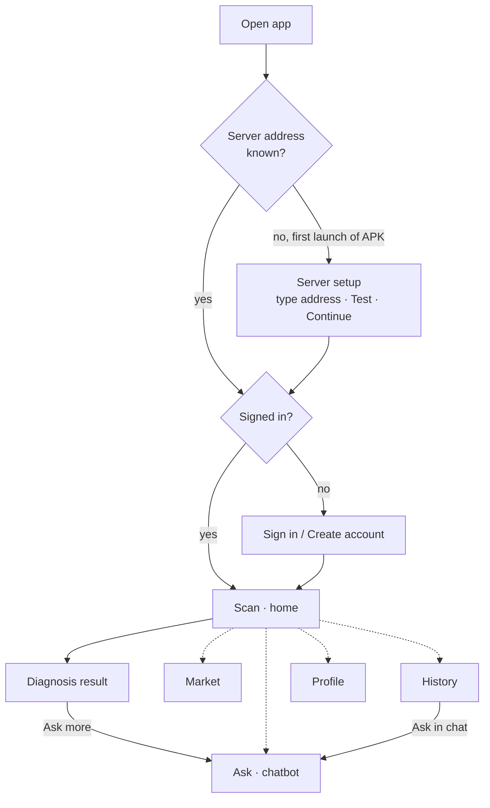
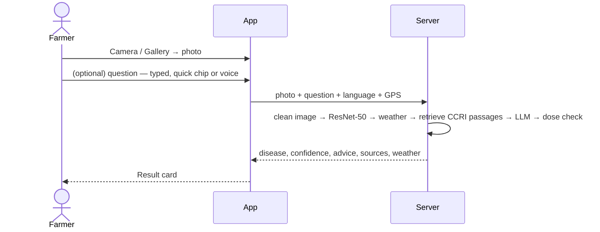

# 2. User flows (the normal flow, screen by screen)

This is also a good **demo script** for the panel. Every screen has the language switch (top bar, and inside every sheet),
so any step can be shown in Kannada.

Bottom navigation: **Scan · Ask · Market · History · Profile** (Scan is the raised centre button).

## 2.1 First launch (APK only)
1. The app opens on **"Connect to your PlantIQ server"**.
2. The farmer (or helper) types the address printed by the laptop, e.g. `192.168.1.15:8000`. The app adds `http://` and the port
   if missing.
3. **Test** pings the server and shows "Connected · 42 ms" or a clear reason it failed. **Continue** saves it.
4. The address can be changed later from the server button (top bar, with a green/amber/red status dot) or Profile → Server.

## 2.2 Create an account / sign in
**Create account**: full name → username (live "Available / Already taken") → mobile number and/or email → password with a
strength bar and a checklist (8+ characters, letters and numbers, not common, not the username) → confirm password → app
language → accept terms. Mistakes are explained next to the field.

**Sign in**: one box for phone, email *or* username, password with show/hide, "keep me signed in". After 5 wrong attempts the
account is locked for 15 minutes and the screen shows a countdown.

## 2.3 Scan a leaf (Module 1 + 2)

1. **Home** shows "Scan a leaf" with Camera / Gallery, three photo tips, and **Your estate weather** (risk banner, temperature,
   humidity, rain today, elevation, spray window, 3-day forecast). Location is automatic GPS or typed manually; a guide explains
   how to copy coordinates from Google Maps.
2. After choosing a photo: preview, optional question (quick chips "When to spray?", "Organic option", "Dose per barrel", or
   the microphone), then **Check this leaf**. A 3-step progress shows reading the photo → checking weather → finding advice.
3. **Result**: disease name (English/Kannada) with a confidence ring; a warning if PlantIQ is not fully sure; **What to do**
   grouped as Do today / Spray / Timing / Prevent; "Doses checked" or "Check doses before mixing"; How sure is PlantIQ (all five
   classes); weather at scan time; sources (document + page).
4. **Ask more** opens the chat with the photo and the result already attached. **New scan** starts again.

## 2.4 Ask (chatbot, Module 3)
1. A welcome message and suggestion chips (Weather today, Fertiliser for flowering, Shade lopping).
2. Type or tap the mic (choose Kannada or English, speak, tap again to stop — the text appears in the box).
3. Attach a photo: take a new one **or pick a past scan from history**.
4. Answers use the photo diagnosis, the conversation so far, live weather and CCRI documents. Asking "how is the weather?"
   gives the live readings and whether today suits spraying (or says plainly that location is missing).
5. Conversations are saved: the panel button lists them; rename or delete any conversation; **New chat** starts fresh.

## 2.5 Market (Module 4)
**Buyer**: All lots → search (variety, place, farmer) → sort chips (Nearest, Newest, Price ↑, Price ↓, Most kg) → Filters sheet
(distance 15/30/60/120 km, variety, minimum lot, price range slider, photos only; the button shows "Show 7 lots" live) →
each card shows price per unit and "≈ ₹/kg", distance, photos with captions → **Call**, **WhatsApp** (pre-filled message),
**Route** (Google Maps) → **Report** a suspicious listing once.

**Seller**: **Sell crop** → title, variety chips, quantity + unit (kg, ton, quintal, 50/60 kg bag, custom; shows "= 2,000 kg"),
price + unit (shows "= ₹190 per kg"), name and phone (prefilled), address, estate GPS or typed coordinates, photos with captions →
**Publish**. If anything is missing, a sheet lists each problem with *what to fill* and *why buyers need it*; tapping one jumps to
the field. My lots → **Edit** or **Delete** (with a confirmation that shows the lot).

## 2.6 History
Scans are stored on the server (they survive reinstalling the app), grouped Today / Yesterday / Earlier, filterable
(All / Disease / Healthy). Tap a scan for the full report and **Ask in chat**. Delete one or **Clear all** — a toast offers
**Undo** for 3 seconds.

## 2.7 Profile and settings
Name, username, phone, email and counts (scans, lots, chats). App: language, dark mode, colour theme (Estate Green, Monsoon
Blue, Harvest Amber, Coffee Cherry, Sunlight high-contrast), server. Security: change password (signs other devices out),
signed-in devices (sign out one or all), sign out, delete account (password required, erases everything).

## 2.8 Demo checklist (≈7 minutes)
1. Start server (`scripts\run_backend.bat`), open the APK or `http://localhost:8000`.
2. Create an account → show the strength meter and availability check.
3. Scan the rust sample → result, sources, dose check, weather. Switch to Kannada and back.
4. Ask more → chat answer with the photo; ask "how is the weather for spraying today?".
5. Market → sell a lot with a missing phone number to show the validation sheet → publish → sort by Nearest.
6. History → delete → Undo.
7. Profile → signed-in devices.
