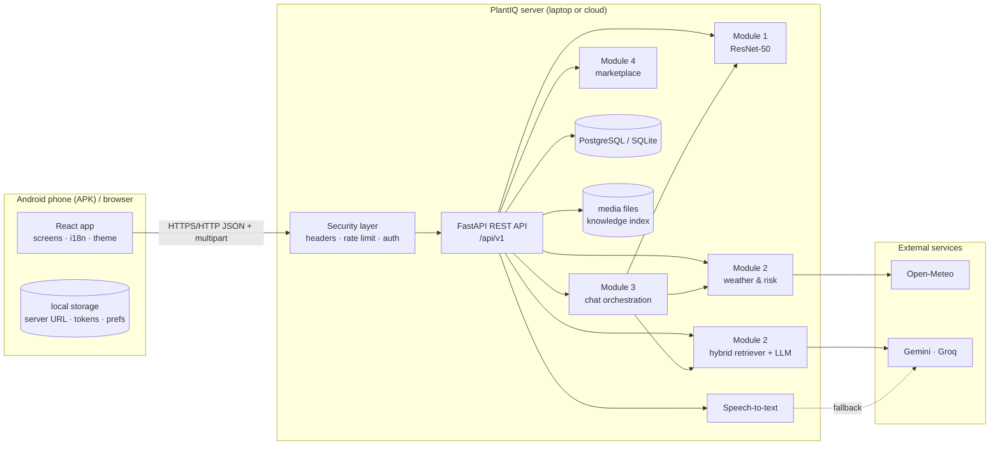
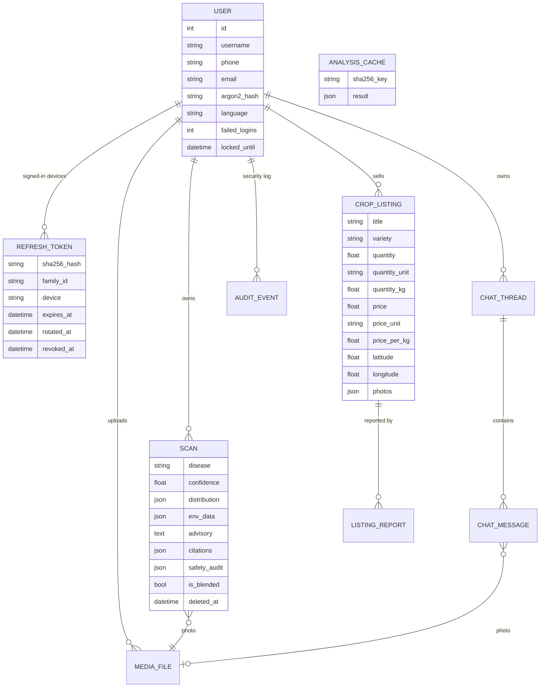
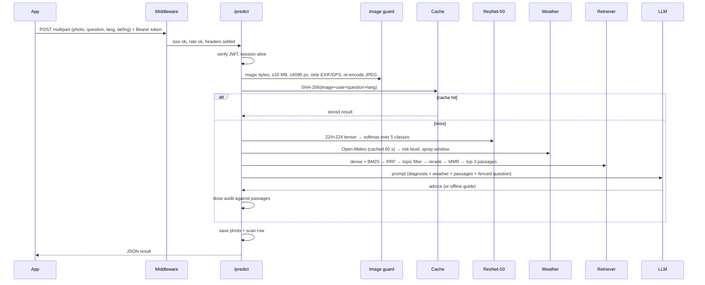

# 3. System architecture

## 3.1 Big picture

**Principles**
- The phone is a thin client; all models run on the server, so cheap phones work and models can be upgraded without a new APK.
- The server URL is chosen at runtime → the same APK works with a laptop on farm Wi-Fi, a tunnel, or a cloud server.
- Every external dependency has a fallback: Gemini → Groq → offline guide; GPU → CPU; quality RAG models → balanced models;
  Postgres → SQLite; local speech models → cloud speech; no weather → explicit "unavailable" (never invented numbers).

## 3.2 Server layers
| Layer | Responsibility |
|---|---|
| ASGI security middleware | Request id, security headers (CSP etc.), 15 MB body limit, global per-IP rate limit, request logging |
| CORS | Allow-list of app origins (APK, web, LAN in development) |
| Routers (`api/`) | auth, users, predict, scans, chat, marketplace, media, voice, environment, system |
| Schemas (`schemas/`) | Pydantic validation and normalisation of every request/response |
| Services (`services/`) | CNN, RAG, LLM client, language router, advisory, environment, chat, voice, storage, auth sessions |
| Registry | Lazily creates each heavy model once (singleton); can swap in deterministic fakes for tests |
| Persistence | SQLAlchemy models; media files on disk; knowledge index (FAISS + JSON) |

Heavy models load **lazily** (first use) or at start with `--warm`. A request never imports a model twice.

## 3.3 Data model

Notes: `deleted_at` on scans enables the 3-second undo (soft delete; purged after 24 h). `ANALYSIS_CACHE` stores diagnosis
results by SHA-256 of image + user + question + language so a repeated photo is answered instantly.

## 3.4 A request end to end — "Check this leaf"

Measured on the development laptop (RTX 3070 Laptop GPU): CNN 5 ms (GPU) / 55 ms (CPU); retrieval ≈ 0.4 s; full diagnosis
≈ 6 s, dominated by the LLM call.

## 3.5 Deployment options
| Option | How | When |
|---|---|---|
| Laptop on farm Wi-Fi | `scripts\run_backend.bat` → phones use `http://<laptop-ip>:8000` | Field demos, co-operatives |
| Cloud VM with GPU/CPU | Docker image (`backend/Dockerfile`) behind a TLS reverse proxy | Many users, internet access |
| Quick public link | `cloudflared tunnel --url http://localhost:8000` | Testing from anywhere |

The server also serves the same web app at `/` so a browser can be used instead of the APK.

## 3.6 Configuration & resilience
All configuration is environment variables (`backend/.env`). Key switches: `RAG_PROFILE` (auto/quality/balanced),
`ML_DEVICE` (auto/cuda/cpu), `ENABLE_LOCAL_*_STT`, `CONFIDENCE_THRESHOLD_CNN` (75 %) and `_RAG` (0.60), rate limits, CORS,
`DATABASE_URL`. Production mode refuses to start with a weak secret key or wildcard CORS and hides the API docs.
