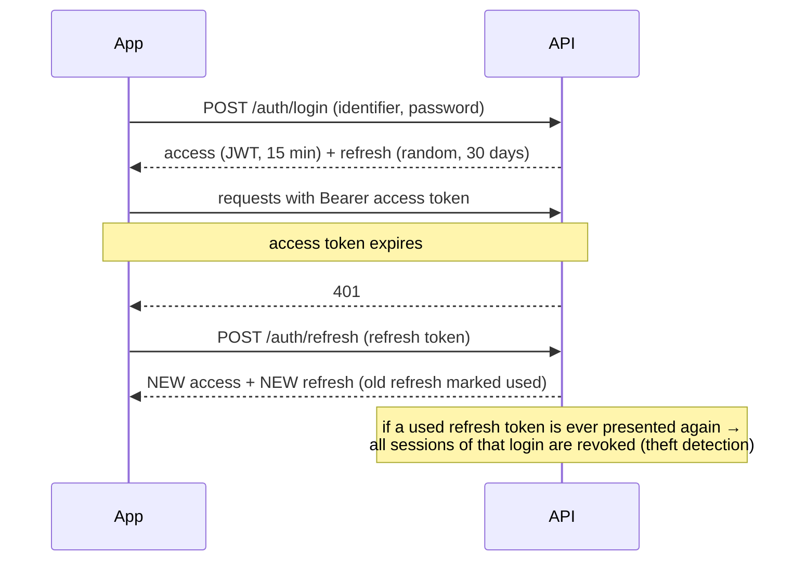

# 4. Platform: accounts, the Android app, languages and design

These pieces are shared by all four modules.

## 4.1 Accounts — improved sign-up and sign-in
| | Original app | Rebuild |
|---|---|---|
| Sign-up fields | name, username, email, password | name, username (live availability), **mobile and/or email**, password + confirm, app language, terms |
| Password rules | none | ≥ 8 chars, letters + digits, not a common password, not the username; live strength bar + checklist |
| Sign-in with | username or email | **username, email or phone** (any format: `+91 98765 43210`) |
| Brute force | unlimited tries | per-IP rate limit + 5 failures → 15-minute lock with countdown |
| Password storage | bcrypt | **Argon2id** (memory-hard); old hashes upgraded automatically at next sign-in |
| Session | one opaque token, 7 days, stored in plain text | 15-minute access token + 30-day (or 1-day) refresh token stored **hashed**, rotated every use |
| Devices | — | list signed-in devices, sign out one or all |
| Account care | delete only | edit profile, change password (signs out other devices), delete with password confirmation |

### Token flow

The app refreshes transparently once on a 401; if that fails the farmer sees "Your session ended" and the sign-in screen.

## 4.2 The Android app
| Topic | Design |
|---|---|
| Packaging | Capacitor 7 wraps the same React app in a native Android shell (`ai.plantiq.claude`, v3.0.0, 4.6 MB) |
| Routing | Hash router (`#/chat`) so the bundle works from the phone's local files and from the server |
| Dynamic server URL | First launch asks for the server; **Test** pings `/health` and shows latency; saved on the phone; changeable from the top-bar server button (status dot) or Profile. No address is baked into the APK |
| URL handling | adds `http://` and port 8000 for LAN addresses, strips trailing slashes, warns when an `http://` address is not on the private LAN |
| Permissions | camera (leaf photos), microphone (voice), location (weather/market), images; requested only when used |
| Native behaviour | Android back button closes the top sheet → returns to Scan → exits; call/WhatsApp/Maps open the right apps |
| Offline feedback | red status dot and an "offline" banner with a retry/check-server button |
| Assets | fonts bundled (works without internet); strict Content-Security-Policy in the bundle |

## 4.3 Languages (English ⇄ ಕನ್ನಡ)
- **The language switch is available everywhere**: in the top bar of every screen (Scan, Ask, Market, History, Profile),
  on the sign-in/sign-up and server-setup screens, and in the header of every bottom sheet (e.g. while filling the Sell form).
  The button names the language you switch *to* ("ಕನ್ನಡ" / "English").
- 425 interface strings in each language; an automated test fails if any key or `{placeholder}` is missing in Kannada.
- The chosen language is remembered on the phone and saved to the profile; Kannada sign-in restores Kannada.
- Disease names, weather words, risk messages, validation reasons and the Google Maps guide are all translated.
- The *content* language is separate: advice and chat answers are produced in Kannada script when the app is in Kannada or the
  farmer writes Kannada/Kanglish.
- Fonts: **Satoshi** for Latin text and **Noto Sans Kannada** for Kannada glyphs (Satoshi has no Kannada).

## 4.4 Design system — "Field Notebook"
Designed for growers outdoors, often one-handed, mixed literacy (full rationale in [../DESIGN.md](../DESIGN.md)):
- warm paper background, leaf-green primary, coffee-cherry accent; 17 px body text; 54 px controls, 64 px main actions;
- every icon has a text label; risk is shown by colour **and** icon, words and a meter;
- bottom sheets instead of pop-ups; undo toasts for reversible actions, confirmation only for irreversible ones;
- five colour themes (Estate Green, Monsoon Blue, Harvest Amber, Coffee Cherry, **Sunlight** high-contrast for direct sun),
  each in light and dark mode;
- phone-first layout tested at 375–412 px wide with no sideways scrolling.

## 4.5 History (server-side)
Scans are stored on the server with their sanitised photo, so they survive reinstalling the app and appear on any device.
Delete is a *soft* delete: the row is hidden immediately, **Undo** within 3 seconds restores it, and soft-deleted rows are
permanently purged after 24 hours (together with their photos).
