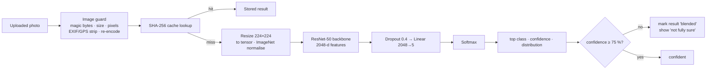

# Module 1 — CNN leaf disease diagnosis

> **One line:** a ResNet-50 convolutional neural network, fine-tuned on coffee leaf photos, looks at one leaf and outputs the
> probability of five classes — Leaf rust, Cercospora leaf spot, Phoma leaf spot, Leaf miner, Healthy.

## 1. Purpose and scope
| Input | Output |
|---|---|
| One photo of a single coffee leaf (JPEG/PNG/WebP, ≤10 MB, ≤4096 px) | `disease` (top class), `confidence` (%), `distribution` (all five classes, sums to 100 %), display names in English and Kannada, latin name, kind (disease / pest / healthy) |

The diagnosis then feeds Module 2 (which advice to retrieve) and Module 3 (chat context). The rebuild uses **the exact same
trained weights** as the original app (`best_resnet50_coffee.pth`, SHA-256 `e1fd039f…`, verified by an automated test).

## 2. Classes
| Class id | English | Kannada | Cause | Type |
|---|---|---|---|---|
| `Rust` | Coffee Leaf Rust | ಕಾಫಿ ಎಲೆ ತುಕ್ಕು ರೋಗ | *Hemileia vastatrix* (fungus) | disease |
| `Cerscospora` | Cercospora Leaf Spot | ಸೆರ್ಕೋಸ್ಪೊರಾ ಎಲೆ ಚುಕ್ಕೆ ರೋಗ | *Cercospora coffeicola* | disease |
| `Phoma` | Phoma Leaf Spot | ಫೋಮಾ ಎಲೆ ಚುಕ್ಕೆ ರೋಗ | *Phoma costarricensis* | disease |
| `Miner` | Coffee Leaf Miner | ಕಾಫಿ ಎಲೆ ಸುರಂಗ ಕೀಟ | *Leucoptera coffeella* (insect larva) | pest |
| `Healthy` | Healthy Leaf | ಆರೋಗ್ಯಕರ ಎಲೆ | — | healthy |

(The id `Cerscospora` keeps the spelling of the trained output layer; only display names are corrected.)

## 3. Pipeline

### 3.1 Pre-processing
1. **Sanitising** (security + robustness): only real JPEG/PNG/WebP (checked by file signature, not extension); rejects empty,
   oversize, decompression-bomb images; applies the camera's EXIF rotation, then **drops all metadata including GPS**, and
   re-encodes to clean JPEG.
2. **Model input**: convert to RGB → resize to 224 × 224 → tensor in [0, 1] → normalise per channel with ImageNet statistics
   mean = (0.485, 0.456, 0.406), std = (0.229, 0.224, 0.225). This is identical to how the model was trained.

### 3.2 Architecture
ResNet-50 (He et al., 2016) is a 50-layer CNN built from **bottleneck residual blocks**:
`1×1 conv (reduce) → 3×3 conv → 1×1 conv (expand)` with a skip connection that adds the input to the output:

  **y = F(x, {Wᵢ}) + x**

The skip connection lets gradients flow through very deep networks (fixing the "degradation" problem), so the network can learn
layered features: leaf texture and veins → lesion borders and halos → spore pustule patterns.

| Part | Detail |
|---|---|
| Backbone | Stem (7×7 conv, max-pool) + 4 stages of bottleneck blocks (3, 4, 6, 3 blocks) → global average pooling → 2048 features |
| Classification head | `Dropout(p = 0.4)` → `Linear(2048 → 5)` |
| Parameters | 23.5 million (measured) |
| Output | 5 logits *z* → softmax |

### 3.3 Softmax and confidence
  **P(class i | image) = e^(zᵢ) / Σⱼ e^(zⱼ)**

`confidence` = the largest probability ×100; `distribution` = all five ×100. If confidence < **75 %**
(`CONFIDENCE_THRESHOLD_CNN`) the result is flagged **blended**: the UI says "PlantIQ is not fully sure", and the advice
prompt asks the LLM to mention look-alike diseases and suggest checking more leaves.

### 3.4 Training (performed by the original project; weights reused unchanged)
| Setting | Value |
|---|---|
| Starting point | ImageNet-1K pre-trained ResNet-50 (transfer learning) |
| Loss | Weighted cross-entropy (class imbalance) |
| Optimiser | AdamW (β₁ 0.9, β₂ 0.999, weight decay 1e-4) |
| Learning rate | Cosine annealing with warm-up |
| Augmentation | Random affine, colour jitter ±15 % (canopy shade), horizontal/vertical flips, Gaussian blur |
| Reported accuracy | 96.4 % top-1 on the held-out set (original project's evaluation) |

### 3.5 Why ResNet-50 (model selection, from the original evaluation)
| Model | Params | Reported top-1 | CPU latency | Verdict |
|---|---|---|---|---|
| **ResNet-50** | 25.5 M | **96.4 %** | ~65 ms | chosen — best texture discrimination for its size |
| MobileNetV3-L | 5.4 M | 89.1 % | ~22 ms | confused early Cercospora vs Phoma |
| VGG-16 | 138 M | 93.8 % | ~195 ms | too large, overfits |
| ViT-B/16 | 86.6 M | 92.5 % | ~280 ms | needs far more data (no locality bias) |
| DenseNet-121 | 8.0 M | 94.2 % | ~110 ms | memory-bandwidth heavy |

## 4. Engineering in the rebuild
| Aspect | Implementation |
|---|---|
| Safe weight loading | `torch.load(..., weights_only=True)` **and** PyTorch 2.7.1 (≥ 2.6 required: CVE-2025-32434 allowed code execution through `torch.load` even with `weights_only=True` in older versions) |
| Device | CUDA automatically if available, else CPU (`ML_DEVICE` to force) |
| Concurrency | One model instance per process (lazy singleton), inference under a lock with `torch.inference_mode()` |
| De-duplication cache | Key = SHA-256(image bytes + user id + question + language). Same photo + same question → instant answer; different users never share results |
| History | Every scan (including cache hits) is stored with its sanitised photo for the History screen |
| Display names | English/Kannada names and latin names returned by the API; UI never shows the raw class id |

## 5. Results
| Measurement | Value |
|---|---|
| Five sample leaves (rust, cercospora, miner, phoma, healthy) | **5 / 5 correct**, confidence 99.5–100 % |
| Inference latency (RTX 3070 Laptop) | 5.3 ms median on GPU · 54.9 ms on CPU |
| Determinism | Same image → identical output (tested) |

## 6. Failure handling
- Not an image / corrupted / too large → clear 4xx message, nothing is run.
- Model error → generic "something went wrong (reference id)" — no internals leak; logged with the request id.
- Low confidence → blended result, never a silent wrong answer.

## 7. Limitations and future work
- Trained on five classes only: other problems (e.g. black rot, nutrient deficiency) will be forced into the nearest class —
  mitigated by the confidence gate. Future: an "unknown / not a coffee leaf" class or out-of-distribution detection.
- One leaf per photo works best; whole-plant photos are out of scope.
- Future: temperature-scaling calibration, Grad-CAM heat-maps to show *where* the disease is, on-device (TFLite) inference.

**Tests:** `tests/ml/test_real_models.py` (real weights), `tests/unit/test_uploads.py` (image guard),
`tests/integration/test_predict_scans_api.py` (pipeline, cache, history, failures).
