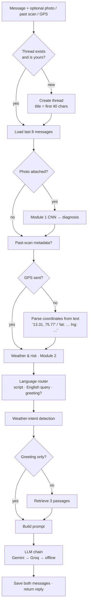
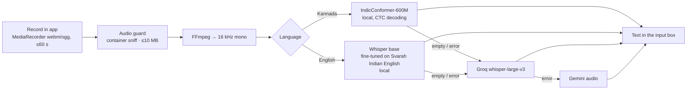

# Module 3 — Chatbot (multilingual, multimodal agronomy assistant)

> **One line:** a conversation assistant that answers coffee-farming questions in English, Kannada or Kanglish, remembers the
> conversation, understands an attached leaf photo or a past scan, knows the live weather at the estate, and accepts voice.

## 1. What makes it more than a generic chatbot
| Capability | How |
|---|---|
| Grounded answers | Retrieval from the same CCRI knowledge index as Module 2 |
| Photo understanding | Attached photo → Module 1 CNN → diagnosis injected into the prompt |
| Scan hand-off | "Ask more" from a result or history sends the disease, confidence, advice and weather of that scan |
| Weather-aware | Live readings for the farmer's location; detects weather questions in English and Kannada |
| Kannada & Kanglish | Language router + Kannada-script replies |
| Voice | Speech-to-text: IndicConformer (Kannada), Whisper Indian-English, cloud fallbacks |
| Memory | Threads stored on the server; last 8 messages used as context |

## 2. Message pipeline (`services/chat.py`)

### 2.1 Language router (`services/lang_router.py`)
Each message is classified into **Kannada script**, **Kanglish** (Kannada written in English letters, e.g.
*"Coffee beliyalu yaava gobbara beku?"*) or **English**, and turned into English search keywords.
1. A small JSON prompt to the LLM (temperature 0.1) returns `{detected_script, search_query_english, is_greeting_or_location_only,
   target_response_language}`.
2. If the LLM is unavailable or returns invalid JSON, a **heuristic router** decides: Kannada Unicode range (U+0C80–U+0CFF),
   a list of common Kanglish words, greeting words, or a single capitalised place name.
3. Kannada script in the message always forces a Kannada reply; the app language setting also requests Kannada.

### 2.2 Context assembled for the LLM
| Block | Source |
|---|---|
| `<history>` | last 8 messages ("Farmer: …", "PlantIQ: …"), each cleaned and capped |
| Live estate conditions | region, temperature, humidity, rain, wind, elevation, soil pH (est.), risk, spray window — or "not available" |
| Attached photo | "PlantIQ ResNet-50 diagnosis: Coffee Leaf Rust (94.1 % confidence)" |
| Past scan | disease, confidence, advice given at scan time, weather logged at scan |
| `<agronomic_context>` | 3 retrieved passages with source and page |
| `<user_query>` | the cleaned message |
| Rules | never say "I can't see images" when a diagnosis is present; use past-scan data; name disease, symptoms, causes and CCRI management; short bullet points; don't invent doses; weather rule (report readings and spray suitability, or say plainly that location is missing and never invent numbers) |

### 2.3 Weather questions
Keyword detection in English (*weather, rain, humidity, temperature, forecast, spray today…*) and Kannada
(*ಹವಾಮಾನ, ಮಳೆ, ತಾಪಮಾನ, ತೇವಾಂಶ…*). Weather questions retrieve microclimate/disease-risk passages and get the special weather rule.
Coordinates typed in the message are used when the app did not send GPS.

### 2.4 Offline mode
Without any LLM: if a disease is known → the bilingual offline disease card; otherwise → live weather summary (or the
"location not available" sentence) plus excerpts from the retrieved passages.

## 3. Photos in chat
- **New photo**: sanitised like Module 1 (EXIF/GPS stripped, re-encoded), stored, CNN runs on it.
- **From history**: the app sends the photo's id; the server checks the photo belongs to *this* user, then reuses it.
- **Original API compatibility**: base64 `image_base64` still accepted.
- Photos are saved with the message and shown again when a conversation is reopened.

## 4. Threads
List (newest activity first, message counts), open, rename, delete, new chat. Threads are private: another user gets
403 for reading, writing into or deleting someone else's thread (tested).

## 5. Voice input (`services/voice.py`)

- The farmer picks the language before speaking (a bilingual sheet), because short agricultural phrases are hard to
  language-detect automatically.
- Local models run on the GPU when available and load on first use (20–40 s once). Each can be switched off in `.env`
  (`ENABLE_LOCAL_STT`, `ENABLE_LOCAL_KANNADA_STT`, `ENABLE_LOCAL_ENGLISH_STT`).
- Transcribed text is placed in the box for the farmer to check before sending (never auto-sent).

## 6. Results
| Check | Result |
|---|---|
| Weather question with GPS (real run) | Reported live readings for Chikkamagaluru, risk level and spray advice |
| Kannada advisory (real run) | Full Kannada-script answer from Gemini after the truncation fix |
| Provider fallback | Gemini 429 → Groq answered automatically |
| Local STT | Whisper (English) and IndicConformer (Kannada) loaded on CUDA |

## 7. Limitations and future work
- Conversation memory is the last 8 messages (no long-term summary).
- Kanglish detection by word list can miss rare spellings (the LLM router covers most cases).
- Future: text-to-speech replies for low-literacy users; streaming responses; measured STT accuracy on recorded farmer speech.

**Tests:** `tests/integration/test_chat_api.py` (threads, history in prompt, photos, media reuse, scan hand-off, coordinates,
weather with/without location, Kannada, offline, isolation), `tests/unit/test_services.py` (router, coordinates, weather intent),
`tests/security/test_security.py` (prompt injection fencing, secret redaction), E2E chat tests.
