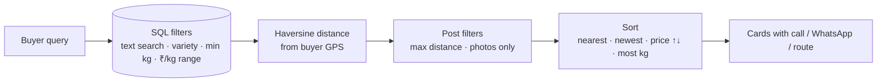

# Module 4 — Market discovery (farmer marketplace)

> **One line:** growers list coffee lots in whatever unit they think in (bags, quintals, tonnes); PlantIQ normalises everything to
> kilograms and ₹/kg, so buyers can search, filter and sort lots by real distance and price, then call or WhatsApp the farmer
> directly — no middleman in the app.

## 1. Data held per listing
| Field | Rule |
|---|---|
| Title, variety | required (≥3 / ≥2 characters); variety chips Arabica / Robusta / Liberica or free text |
| Quantity + unit | > 0; units kg, ton, quintal, bag (50 kg), bag (60 kg) or custom ("25 kg sack") |
| Price + price unit | > 0, ≤ ₹10,00,000; per kg / ton / quintal / 50 kg bag / 60 kg bag / custom ("per 2 kg") |
| `quantity_kg`, `price_per_kg` | **computed by the server** (never trusted from the client) |
| Farmer name, phone | phone must be exactly 10 digits (`+91`, spaces and dashes removed) |
| Address | required |
| Latitude / longitude | optional; auto GPS or typed in the form |
| Photos | up to 8, each with a caption (uploaded first as sanitised images) |
| Owner | the signed-in user (required) |

## 2. Unit normalisation (`schemas/marketplace.py`)
| Unit text contains | Quantity → kg | Price → ₹/kg |
|---|---|---|
| `ton` / `tonne` (optionally "2 ton") | qty × n × 1000 | price ÷ (n × 1000) |
| `quintal` | qty × n × 100 | price ÷ (n × 100) |
| `50kg` | qty × 50 | price ÷ 50 |
| `60kg` | qty × 60 | price ÷ 60 |
| "*x* kg" (custom) | qty × x | price ÷ x |
| anything else | qty (as kg) | price |

Example: 40 bags (50 kg) at ₹9,500 per 50 kg bag → **2,000 kg at ₹190/kg**. The form shows "= 2,000 kg" and "= ₹190 per kg"
live, and each card shows the farmer's own price plus "≈ ₹190/kg" for comparison. Bounds: total ≤ 100,000 kg.

## 3. Discovery: search, filter, sort (`api/marketplace.py`)

| Feature | Detail |
|---|---|
| Text search | case-insensitive match on title, variety, address, farmer name (bound parameters, injection-safe) |
| Variety filter | All / Arabica / Robusta / Liberica (substring match) |
| Minimum lot | ≥ 50 kg / ≥ 200 kg / ≥ 1 ton (on normalised kg) |
| Price range | dual slider + boxes, ₹0–1000+/kg (on normalised ₹/kg) |
| Distance | Any / 15 / 30 / 60 / 120 km from the buyer's GPS |
| Photos only | lots with at least one photo |
| Sort | nearest (lots without GPS last), newest, price low→high, high→low, largest quantity |
| Live count | the filter sheet shows "Show N lots" before applying |

### 3.1 Haversine distance
Great-circle distance between buyer (φ₁, λ₁) and lot (φ₂, λ₂), Earth radius R = 6371 km:

  **a = sin²(Δφ/2) + cos φ₁ · cos φ₂ · sin²(Δλ/2)**  
  **d = 2R · atan2(√a, √(1−a))**

Rounded to 0.1 km and shown as "8.4 km". Computed on the server for every lot (fine for thousands of listings; a spatial index
would be added beyond that).

## 4. Contacting the seller
- **Call** → `tel:` link · **WhatsApp** → `https://wa.me/91<phone>?text=Hi <name>, I saw your PlantIQ listing for <title>.`
- **Route** → Google Maps search at the lot's coordinates (or the address if no GPS).
- The app only opens `https:`/`tel:` style links (never `javascript:`); on Android they open the right app.

## 5. Selling, editing and moderation
| Action | Rules |
|---|---|
| Publish | sign-in required; max 50 listings per user; photos must be the seller's own uploads |
| Validation sheet | client-side check lists every problem with **what to fill** and **why buyers need it**; tapping jumps to the field. The server repeats all checks |
| Edit / Delete | owner only (others get 403); delete asks for confirmation and shows the lot |
| Report | any other user, once per listing (reason list + details); stored for moderators; own listing cannot be reported |
| Text safety | angle brackets stripped from free text; React escapes everything on display |

## 6. Improvements over the original marketplace
- Fixed: anonymous users could create listings and anyone could edit/delete "ownerless" ones.
- Photos stored as sanitised files instead of base64 strings inside database rows (faster lists, no EXIF/GPS leaks).
- Report button in the app (the original only had the API), duplicate reports blocked.
- Filters moved into a sheet with a live result count; sort chips instead of a dropdown.

## 7. Results
Covered by integration tests (units, photos, every filter and sort order, owner rules, report once, quota), a functional
seller/buyer journey, a 500-listing performance test (distance sort < 1.5 s) and two E2E tests (seller flow and two-user report).

## 8. Limitations and future work
- No in-app payments or price negotiation (contact happens by phone/WhatsApp).
- No moderator dashboard yet for reports.
- Future: price trends per variety, buyer alerts for nearby lots, spatial index for large volumes.

**Tests:** `tests/integration/test_marketplace_api.py`, `tests/unit/test_schemas.py` (unit/price tables, validation),
`tests/functional/test_journeys.py`, `tests/nonfunctional/test_performance.py`, `frontend/e2e/app.spec.ts` (marketplace).
