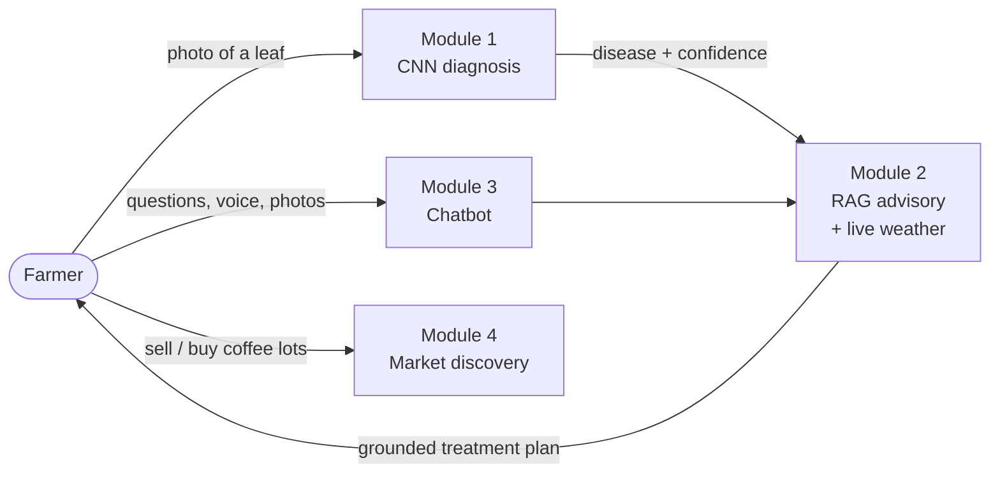

# 1. Project overview

## 1.1 The problem
Karnataka grows most of India's coffee, largely on small holdings in Chikkamagaluru, Kodagu and Hassan. Three problems keep
coming back for these growers:

1. **Late disease detection.** Coffee leaf rust, Cercospora leaf spot, Phoma blight and leaf miner spread quickly in the
   humid monsoon. By the time an extension officer visits, a block can already be infected.
2. **Generic advice.** Spray recommendations depend on the disease *and* on the weather (spraying before rain wastes the
   chemical; high humidity favours rust). Printed manuals do not adapt to today's conditions, and most are in English.
3. **Weak market access.** Growers sell to the nearest middleman because buyers cannot easily find small lots nearby.

## 1.2 The solution
PlantIQ is an Android app (plus web app) backed by a server that can run on a laptop at home or in the cloud.

| Module | What it does for the farmer | Core technology |
|---|---|---|
| **1. CNN leaf diagnosis** | Photograph one leaf → name of the disease (or healthy) and how sure the model is | ResNet-50 convolutional neural network (transfer learning), 5 classes |
| **2. RAG advisory + environmental data** | A treatment plan grounded in Central Coffee Research Institute (CCRI) documents and adjusted to live weather at the estate, with a "spray window" | Hybrid retrieval (dense bge-m3 + BM25 + rank fusion + cross-encoder reranking) → LLM (Gemini/Groq) → dose check; Open-Meteo weather + fungal-risk model |
| **3. Chatbot** | Ask follow-up questions by typing or speaking, in English, Kannada or "Kanglish", with photos or past scans attached | Language router, retrieval, conversation memory, speech-to-text (IndicConformer for Kannada, Whisper for Indian English) |
| **4. Market discovery** | List a coffee lot with photos; buyers search, filter and sort by distance and call/WhatsApp directly | Unit normalisation to ₹/kg, Haversine distance, multi-criteria filters |

Cross-cutting: secure accounts (phone/email/username sign-in), bilingual UI (English/ಕನ್ನಡ switchable on every screen),
offline-friendly design, and a server address that can be changed inside the app.

## 1.3 Objectives and how they are met
| Objective | How PlantIQ meets it | Evidence |
|---|---|---|
| Accurate diagnosis from a phone photo | ResNet-50 fine-tuned on coffee leaves | 96.4 % top-1 reported by the training run; 5/5 sample leaves correct at 99.5–100 % in our run |
| Trustworthy advice | Answers grounded in retrieved CCRI passages, with citations and an automatic dose check | Citations + "Doses checked" badge on every result |
| Advice that fits today's weather | Live temperature, humidity, rain, elevation; fungal-risk level; 3-day spray window | Weather tiles and risk banner on the scanner and in results |
| Usable by farmers | Kannada everywhere, voice input, large buttons, icon + text, high-contrast theme | 12 end-to-end tests incl. an accessibility sweep |
| Fair market access | Distance-sorted listings, direct call/WhatsApp, normalised ₹/kg prices | Marketplace tests (filters, sort, units) |
| Safe and private | Strong password hashing, short-lived tokens, rate limits, upload sanitising, owner-only edits | 58 security tests |

## 1.4 Users
- **Grower** (primary): scans leaves, reads advice, chats, sells lots. Often outdoors, Kannada-first, budget Android phone.
- **Buyer / trader / roaster**: browses lots near them, contacts sellers.
- **Operator** (co-op, college, NGO): runs the server on a laptop or VM, sets API keys.

## 1.5 Technology stack
| Layer | Technology |
|---|---|
| Mobile app | React 18 + TypeScript (Vite), packaged with Capacitor 7 as an Android APK |
| Server | Python 3.11, FastAPI, SQLAlchemy 2 (PostgreSQL or SQLite) |
| Deep learning | PyTorch 2.7 (CUDA), torchvision ResNet-50 |
| Retrieval | FAISS, rank-bm25, sentence-transformers (BAAI bge-m3, bge-reranker-v2-m3) |
| Language models | Google Gemini 2.5 Flash → Groq gpt-oss-120b → built-in offline guide |
| Speech | ai4bharat IndicConformer-600M (Kannada), Whisper fine-tuned on Indian English (Svarah), cloud fallbacks |
| Weather | Open-Meteo forecast API |
| Security | Argon2id, JWT + rotating refresh tokens, CSP headers, rate limiting |

## 1.6 What changed from the first version
This rebuild (v3) keeps every feature of the original app and the same trained CNN, and adds:
a stronger multilingual RAG pipeline, server-side scan history with undo, a redesigned farmer-first interface,
improved sign-up/sign-in, a 3-day spray window, report-a-listing, photo uploads stored safely, an offline advice fallback,
and a full security and testing overhaul (fixing several vulnerabilities in the original). Details: [FEATURES.md](../FEATURES.md). The original app is kept in [`og/`](../og/).
